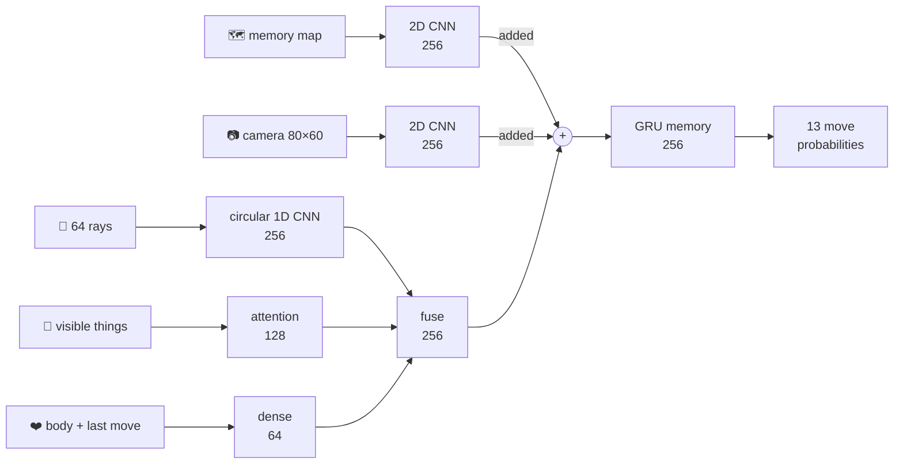
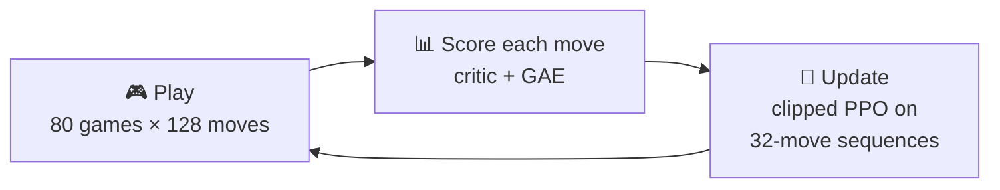

<div align="center">

# 🎮 Can It Play DOOM?

**A neural network that plays Doom levels it has never seen.**
It fights, explores, picks up keycards, opens doors and looks for the exit.

*Yugaantar 2026 · DevForge · Track 1*


| 🧠 Weights | ⚡ Per decision | 🏋️ Training (submitted brain) | 📏 Limit per decision |
|:---:|:---:|:---:|:---:|
| **1.96 M** | **~3 ms** on 1 CPU thread | **37 M** game steps | 40 ms |

[How it plays](#plays) · [Training](#training) · [Testing](#testing) · [Results](#results) · [Rules](#rules) · [Run it](#run) · [Reproduce](#reproduce)

</div>

---

> [!IMPORTANT]
> **Every action comes from the trained network.** No hand-written rules, no path-finding, no aim-bot.
> The network, the PPO trainer, the reward and the map generator were all written during the event.

<a name="plays"></a>

## 🕹️ How it plays

Every 4 game ticks (about 9 times a second), the agent receives what the player senses and the
network picks one of **13 moves**: button combinations such as *forward + turn left* or *forward + attack*.

| Sense | What it is | How the network reads it |
|---|---|---|
| 📡 **64 rays** | A 360° "lidar": distance and what each ray hit (wall, door, locked door, enemy, item) | 1D CNN with **circular padding**, because the rays form a ring |
| 👾 **Visible things** | Up to 32 enemies and items in view: kind, distance, direction, relative speed | **Attention pooling**, for any number of things in any order |
| ❤️ **Body** | Health, armour, ammo, keys, speed, and the previous move | Small dense layer |
| 🗺️ **Memory map** | A top-down map the agent **draws itself** from its rays and what it saw | 2D CNN over a near and a far crop |
| 📷 **Camera** | The screen, shrunk to 80 × 60 | Small 2D CNN; the exit pad only shows up in pixels |



- **Memory (GRU).** The game only shows what is in sight, so a 256-number memory is carried from one
  decision to the next ("there was a locked door behind me"). It is wiped at the start of every map.
- **The memory map** knows nothing the observation doesn't tell it. The agent tracks its own position
  by adding up its own speed and turns, then paints its rays (free space, walls, doors, locked doors),
  keys, enemies and its own trail onto a grid. See [`submission/memory_map.py`](submission/memory_map.py).

**Code:** [`doom_net.py`](submission/doom_net.py) (network) · [`features.py`](submission/features.py)
(input preparation, move list) · [`agent.py`](submission/agent.py) (the evaluated `DoomAgent`)

<a name="training"></a>

## 🏋️ How it was trained

**Recurrent PPO, written from scratch** in [`training/ppo.py`](training/ppo.py).



| Step | Detail |
|---|---|
| **Play** | 10 processes × 8 games, 128 moves each, with the current network |
| **Score each move** | A critic estimates how well things should go; each move's *advantage* is how much better or worse it turned out (GAE, γ = 0.995, λ = 0.95) |
| **Update** | Clipped PPO (0.2), 4 passes × 4 minibatches on 32-move sequences, so the memory learns too. Adam; learning rate 3e-4 → 1e-4 and entropy bonus 0.01 → 0.001 in Run 1, then 1e-4 → 5e-5 and 0.005 → 0.001 in Run 2 |

### What we added on top of plain PPO

| | Technique | Why |
|---|---|---|
| 🔍 | **Asymmetric critic** | In training only, the critic also sees hidden facts (time used, health, kills, keys, doors, area explored). Better advantage estimates; the policy never sees them. |
| 🏗️ | **Procedural maps** ([`mapgen.py`](training/mapgen.py)) | Random levels in tiers like the hidden suite: combat, multi-room, key + locked door, double-key gauntlet, plus a small "key school". With `--switch-exit`, the exit is a wall switch you press, as in real Doom levels. Each map is checked before saving: exit reachable, each locked door really blocks it, each key before its door. |
| 🪞 | **Left-right mirroring** | Half the games are mirrored (rays, things, camera, map and moves all flipped), doubling the variety. |
| 🎯 | **Prioritized maps** (`--plr`) | Maps it wins about half the time are picked more often, because they teach the most; half of all picks stay random. |
| 🎁 | **Reward shaping** ([`rewards.py`](training/rewards.py)) | Follows the scoring priorities: exit > keys and doors > exploring > combat. "Once per" rules mean nothing can be farmed. |
| 🔁 | **Warm start** | Run 2 started from the Run 1 brain. Its new map and camera inputs start at zero, so it began playing exactly like Run 1 and learned to use them gradually. |

<details>
<summary><b>Full training reward</b> (computed from the game's ground truth, training only)</summary>

| Event | Reward |
|---|---|
| Reach the exit | +10, + up to 2 for health left, + up to 2 for time left |
| Key picked up / locked door opened (once each) | +3 / +3 |
| Normal door opened (once each) | +0.5 |
| New 64 × 64 area entered | +0.05 |
| Kill | +0.5 |
| Health lost | −0.01 per point, up to 2× when health is low |
| Health gained | +0.01 per point |
| Death | −3, more if early |
| Time runs out | −1 |
| Every move | −0.001 |
| Firing with no enemy ahead | −0.02 |
| Entering the same area a 3rd+ time | −0.02 (stops circling) |
| Enemy within arm's reach | −0.02 per move |
| Fireball or rocket within 160 units | −0.05 per move (step aside) |
| A bullet-firing enemy can see it and it isn't aiming at that enemy | −0.01 per move (−0.03 for a chaingunner) |
| Hurt by something out of view, then turns and finds it within 12 moves | +0.15 |
| Chaingunner killed | +1 on top of the normal kill |
| Pressing USE right in front of a closed door | +0.05 (limited per game) |
| Pressing USE next to the exit (exit switches need USE) | +0.1 (at most 5 per game) |
| Standing next to a locked door without its key | −0.02 per move |
| Barely moving for 24 moves (stuck) | −0.01 per move |
| Picking up a better weapon (shotgun, chaingun) | +1 to +1.5, once per upgrade |
| Getting closer to a **visible** key | +0.001 per map unit (potential-based: going back and forth adds up to zero) |
| Getting closer to a visible weapon, until it has a chaingun | +0.002 per map unit (potential-based) |
| Holding a key: getting closer to the locked door it opens | +0.001 per map unit (potential-based; door positions read from the map file, training only) |
| Getting closer to the exit, within 512 units | +0.004 per map unit (potential-based; exit position read from the map file, training only) |

The combat, door, weapon and stuck terms were added partway through Run 2, as we saw where the agent struggled.

</details>

<a name="testing"></a>

## 🧪 How we test it

- **Mini-scorer** ([`score.py`](training/score.py)) copies the official scoring categories (exit with
  health and time bonus, keys, locked doors, doors, exploration, kills, damage, early death),
  multiplies by tier, and runs the real `DoomAgent` on one CPU thread.
- **Held-out maps:** 20 generated maps (5 per tier), never used for training, each played 3 times
  with different seeds.
- **Final pick** ([`final_pick.py`](training/final_pick.py)) compares saved brains on five sets: our
  held-out maps, freshly generated maps, maps with switch exits, the Freedoom levels that ship with
  ViZDoom, and community map packs. Every candidate must run with no errors and within the time limit.

<a name="results"></a>

## 📈 Results

**The submitted brain: 37.0M steps of Run 2**

Training went on well past the table below, so we compared the saved brains at the end. Two stood out:

| Brain | Evaluation-style maps | Five-set final pick |
|---|---:|---:|
| Run 2 · **37.0M** steps (submitted) | **3,732** | ×1.32 |
| Run 2 · 49.0M steps | 3,408 | ×1.45 |

**Evaluation-style maps** are 12 new levels built to match [`docs/EVALUATION.md`](docs/EVALUATION.md):
3 per tier for tiers 1–4, two with a floor exit and one with an exit switch, each played twice. They were
made with `mapgen.py --seed 9090` (floor exits) and `--seed 9191 --switch-exit`, and neither run trained on them.
The 49.0M brain was slightly ahead on the five-set final pick, which includes real Doom maps. We submitted
the 37.0M brain because the evaluation-style maps are the closest match to how judging works.

**Score on our held-out maps during training** (20 maps × 3 games)

| Brain | Score | |
|---|---:|---|
| Run 1 · 16.6M steps | 2,140 | `██████████` |
| Run 2 · 1.25M steps | 3,227 | `███████████████` |
| Run 2 · 5.66M steps | 4,253 | `████████████████████` |
| Run 2 · 9.20M steps | 4,459 | `█████████████████████` |

<!-- Update these tables if the final pick changes the submitted brain. -->

**What each input is worth** (Run 1 brain, one input switched off at a time)

| Switched off | Score |
|---|---:|
| Nothing | 2,140 |
| 👾 Visible things | 1,589 |
| 🧠 Memory (reset every move) | 1,148 |
| 📡 Rays | −617 |

> [!NOTE]
> These maps come from our own generator and were used to choose between versions, so the hidden maps
> may be harder. Our weakest skill is still keycards and locked doors.

<a name="rules"></a>

## ⚖️ Rules

| Rule | How we follow it |
|---|---|
| ✅ Decisions come from trained parameters | `agent.py` samples the move from the network's probabilities. No `if/else` chooses moves. |
| ✅ No path-finding or planning | None anywhere. The memory map is only drawn and given to the network as input. |
| ✅ No trigonometric aim-bot | The network decides when and where to turn. `arctan2` appears only in `memory_map.py`, to place things it saw onto its own map. |
| ✅ Not off-the-shelf SB3 | Our own network and our own PPO trainer. |
| ✅ Evaluation sees only the official observation | Ground truth (`privileged_state()`, the exit position) is used only for training rewards and the critic. The critic is removed from the submitted weights. |

<a name="run"></a>

## 🚀 Run it

Python 3.13 and [uv](https://docs.astral.sh/uv/), from the repository root:

```bash
uv sync --group train                                      # environment + training extras
uv run python validate.py                                  # official checks: interface, speed, limits

uv run python training/mapgen.py --out maps/gen/train   --per-tier 150 --seed 1
uv run python training/mapgen.py --out maps/gen/heldout --per-tier 5   --seed 999 --check

uv run python training/score.py submission/weights/model.pt            # score on the held-out maps
uv run python training/watch.py --ckpt submission/weights/model.pt     # watch it play, with its own map
```

Training, resuming and exporting: see [`training/README.md`](training/README.md).

<a name="reproduce"></a>

## 🔁 How the submitted brain was made

**Maps**

```bash
uv run python training/mapgen.py --out maps/gen/train    --per-tier 150  --seed 1
uv run python training/mapgen.py --out maps/gen/train2   --per-tier 1200 --tiers 1,2,3,4,5 --seed 7
uv run python training/mapgen.py --out maps/gen/train_sw --per-tier 300  --seed 21 --switch-exit   # once per tier
```

Run 1 also used 4 hand-built curriculum maps (`maps/curriculum/train`), which are not in this repository.

**Run 1:** rays, visible things and body only, without `--plr`, on 304 maps. It stopped at 38.0M steps.

```bash
uv run --group train python training/ppo.py --name run1 \
    --maps "maps/gen/train/t1/*.wad,maps/gen/train/t2/*.wad,maps/curriculum/train/*.wad" \
    --total-steps 40e6 --save-every-min 10
```

**Run 2:** adds the memory map and camera, with `--plr` on, starting from Run 1's last save.

```bash
uv run --group train python training/ppo.py --name run2 --maps "maps/gen/train/*/*.wad" \
    --memory-map true --eye true --plr true --init-from runs/run1/ckpt/<last>.pt \
    --total-steps 50e6 --lr 1e-4 --lr-end 5e-5 --ent-coef 0.005 --ent-end 0.001
```

It started on `maps/gen/train` (754 maps). From 18.2M steps it resumed on a weighted mix of `train`, `train2`
and `train_sw` (10,804 maps), with harder tiers picked more often, up to 6× for switch-exit tier 4. We stopped
it at 49.0M steps and exported the 37.0M save (`ckpt_00037048k.pt`) with `training/export.py`. `validate.py` passes.

> [!NOTE]
> Some reward terms were added while Run 2 was running (doors, chaingunners, switch exits, weapon ranking).
> A rerun with today's code uses the same setup but won't give the same weights bit for bit.

**Hardware and time:** one laptop with an Intel i5-12450HX (8 cores, 12 threads), an RTX 3050 6 GB laptop GPU
and 16 GB RAM, running 80 game copies at about 2,400–3,200 steps per second. Run 1 took about 4 hours and
Run 2 about 10 hours, so about 14 hours in total.

## 📁 Repository layout

```
submission/    the evaluated agent: agent.py, doom_net.py, features.py, memory_map.py, weights/ (Git LFS)
training/      ppo.py, rewards.py, mapgen.py, exit_finder.py, score.py, final_pick.py, watch.py, export.py,
               count_shots.py, check_memory_map.py, bench_speed.py
env/           the organisers' ViZDoom wrapper (doom_env); the scorer uses its own copy
docs/          the organisers' contract, rules, evaluation and submission guide
validate.py    the organisers' submission validator
```

## 🔭 Limitations and next steps

- **Keycards and locked doors** are still the weakest skill. Next we would try learning from a few
  recorded human runs (imitation, then PPO) and a curiosity bonus (RND) for long levels.
- **The memory map's self-tracking drifts** over long runs, since it is dead reckoning from speed and turns.
- **All numbers** come from our own test maps; the hidden suite may differ.
